# Venn

Venn finds the businesses whose audiences already overlap with yours, shows that overlap on a dashboard and a map, and drafts the collaboration pitch. Taste comes from [Qloo](https://qloo.com). The agent that uses it is this app.

Built for the Qloo Agentic Hackathon 2026. No API keys are required to run it: the default mode is an offline catalog, and the three built-in examples replay saved real Qloo results.

## The product, in one pass

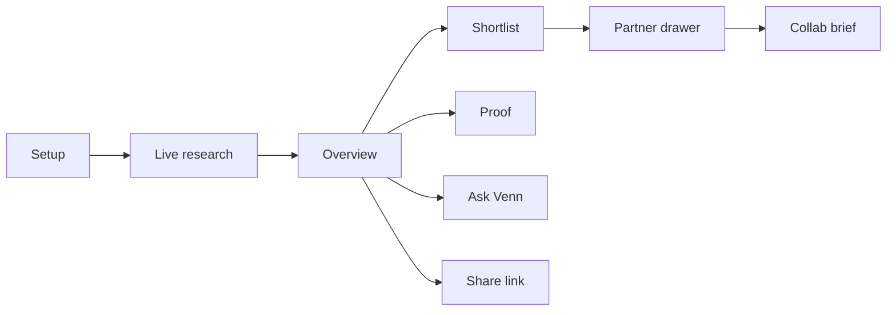

You describe a business in one sentence: what it is, which city, and a few things its customers love. Those loves are **anchors**. Venn resolves them against Qloo's taste graph, picks which kinds of partner to look for, scores the overlap, and streams every step while it works.

Results open on an Overview. One selected partner drives every chart. A Shortlist is the same partners as a table. Proof ranks Venn's picks against an obvious baseline in one Qloo call. Each partner can get a one-page brief and an outreach email. Ask Venn answers questions about this search only.

Match scores describe **groups of taste in this search**. They are not a claim about any person. This demo does not use customer data.

## Run it

Node `>= 22.19`.

```bash
copy .env.example .env
npm install
npm run dev
```

On macOS or Linux, use `cp .env.example .env`.

Open [http://localhost:5173](http://localhost:5173). The API listens on [http://localhost:8787](http://localhost:8787). Vite proxies `/api`, including the live event stream.

`TASTE_PROVIDER` defaults to `mock`. The three example chips still replay saved Qloo results (`EXAMPLES_MODE=snapshot`). Set `TASTE_PROVIDER=qloo` and `QLOO_API_KEY` for live data. Hackathon keys only work against `https://hackathon.api.qloo.com`.

Production is one process: the Fastify server serves `dist/client` and the API together.

```bash
npm run build
npm start
```

Docker:

```bash
docker build -t venn .
docker run --rm -p 8787:8787 -e TASTE_PROVIDER=mock venn
```

Platform notes (Railway, Fly.io, the SQLite volume) are in [docs/DEPLOY.md](docs/DEPLOY.md).

## What you do

### 1. Setup

Two ways to name the crowd, and they share one list of up to six anchors.

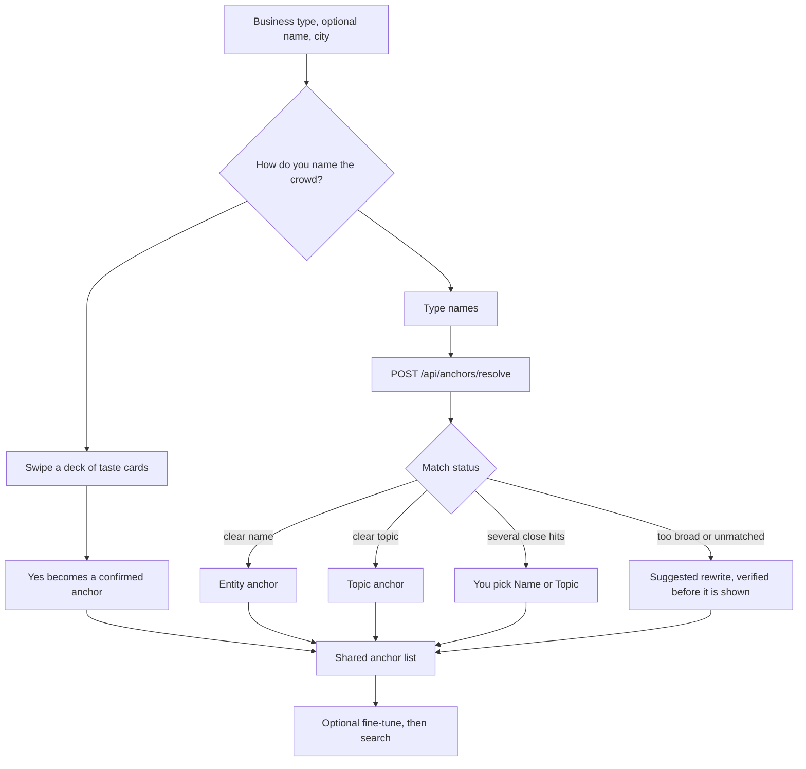

**Swipe your crowd.** A deck of brands, artists, places, and topics. Seeds are resolved to exact Qloo ids ahead of time (`npm run cards:seed` writes `server/anchors/seed-ids.json`), so a Yes goes straight in. After the third Yes, a refill deck is drawn from those Yeses. Each card says where it came from: checked on Qloo, refilled from a Yes, a recorded example, or a sample card that is not from Qloo.

**Type them.** Each chip is searched as an entity, then as a topic. Status is `entity`, `topic`, `ambiguous`, `too_broad`, or `unresolved`. Candidates below a 0.6 similarity floor are never shown. When a phrase is too broad or unmatched, and an LLM is configured, Venn may suggest a rewrite. That suggestion is verified on Qloo before the UI calls it Suggested.

**Fine-tune** is optional and collapsed. Up to two goals (more footfall, a new audience, content, events, bundles, shared costs, stockists), a radius (nearby, local and known brands, anywhere), how bold a collaboration to suggest, and an avoid list. Goals change which kinds are searched first and how the top picks are ordered. They do not change the match score.

Example chips fill the form in one click:

| Business | City | Anchors |
| --- | --- | --- |
| Café, Brew & Co | London | Aesop, Radiohead, pilates |
| Gym or studio | Manchester | Patagonia, craft beer, bouldering |
| Shop, Second Spin Records | New York | Bandcamp, Polaroid, natural wine |

The form remembers the last answers in the browser.

### 2. Research

`POST /api/runs` starts a search and returns a `runId`. The page opens `GET /api/runs/:id/events` and reads Server-Sent Events. A refresh reconnects to the same in-flight search. Cancel aborts it.

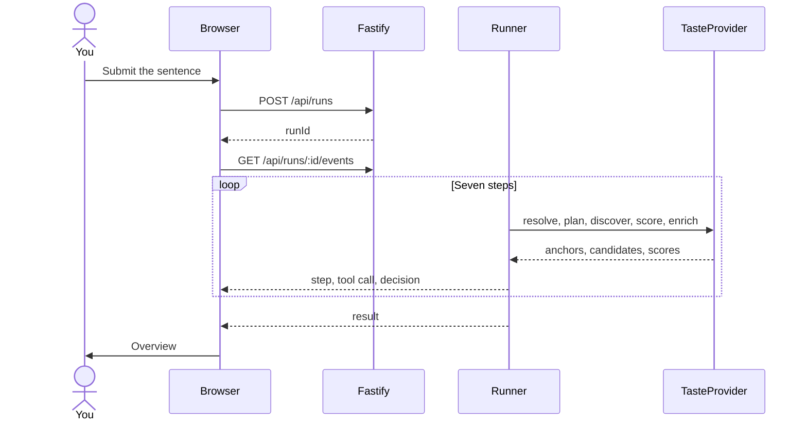

The seven steps, in order:

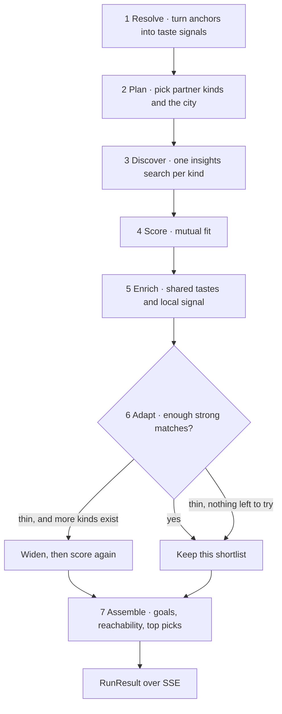

| Step | What you see | What the agent does |
| --- | --- | --- |
| Resolve | Understanding your customers' taste | Confirmed entities and topics become signals. On live Qloo, a topic such as "jazz" is bridged to real entities first, because topic tags alone rarely rank places and brands. |
| Plan | Choosing where to look | The business type maps onto partner kinds: food, drink, venue, music, culture, retail, fashion, fitness, wellness. The city is resolved. If Qloo has no geography for it, the search says so and looks at broader brands and artists. It does not invent a city. |
| Discover | Searching for candidate partners | One insights search per kind. The pool is capped at 22 by provisional fit. |
| Score | Scoring how well each one fits | See [How a match score is made](#how-a-match-score-is-made). |
| Enrich | Checking trends and local popularity | Shared tastes and local signal are attached. A taste is shared only when Qloo puts that tag on both crowds. |
| Adapt | Double-checking coverage | Live Qloo widens only when fewer than 6 partners came back and unused kinds remain. The demo catalog uses a higher bar. A decision log line records why it widened or why it did not. |
| Assemble | Drawing your map | Goals filter and reorder. Unreachable partners drop out. Three top picks are chosen. Feasibility is labelled easy, warm intro, or long shot. |

While this runs, the research screen shows the city filling in, the actual Qloo calls (path, shape, timing), and the decision log. Those decisions stay on the finished result.

A live run with no named brand, artist, or place stops with an explanation. Popular-nearby results with no taste signal would be a misleading map.

### 3. Results

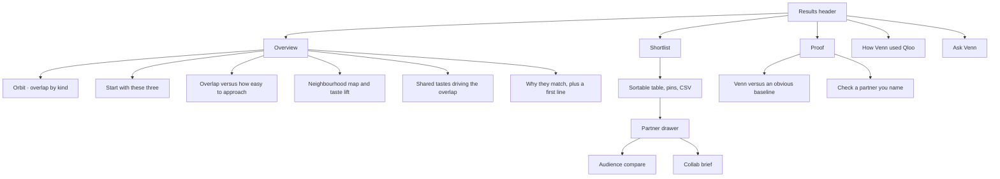

Selecting a partner on any Overview chart selects them on all of them. Press or drag a shared taste (a **taste magnet**) and every chart re-weights around that taste. Filters apply everywhere: partner kind, a safe-fits-to-wildcards slider, and a "realistic for me" toggle that hides long shots.

The map pins local places. A taste-lift toggle switches from raw popularity to where this crowd over-indexes. Brands and artists with no fixed location are listed under the map.

The drawer splits evidence into **data** (a real number) and **interpretation** (what Venn makes of it). When Qloo's explainability names which of your anchors drove the match, that line is shown. Audience compare is built from signals already computed during scoring. It does not fire another Qloo probe.

**Proof** puts Venn's picks and a baseline (the popularity leader, or a well-known name when an LLM suggests one) into the same `rankTogether` call per kind. The scores are comparable because they come from one response. A kind with no recorded discover call shows a note instead of a guessed score.

**Check a partner** scores a name you type on this search's frozen scale and adds it to the Overview as a dashed "Your pick". Up to five per search.

**How Venn used Qloo** lists every live HTTP call from this search, grouped by step. Demo and snapshot runs say plainly that no live calls were made.

## How a match score is made

Live Qloo scores **absolute mutual affinity out of 100**.

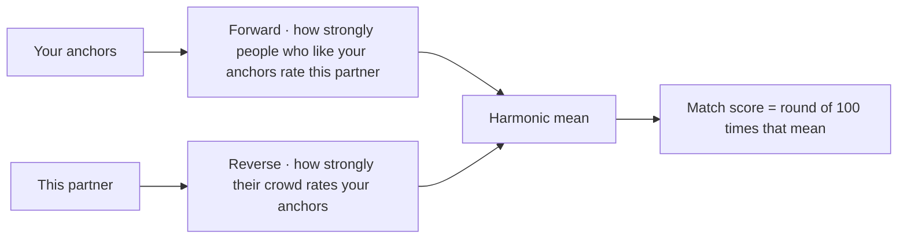

If the reverse affinity cannot be measured, the forward score is used at 0.9 and the evidence says so. Shared tastes are your crowd's tags that Qloo also attaches to the partner, never the partner's tags alone. Drivers are Qloo's explainability share per anchor.

Mock and snapshot runs keep a relative band of 52–96 inside that one search, so the charts still have a spread when every affinity is illustrative. Those scores are relative to the other partners in the run. They are not the live 0–100 formula. The formula and the within-call rank used by Proof live in [docs/SCORING.md](docs/SCORING.md).

Partner kind maps onto the Qloo entity filter like this:

| Partner kind | Insights filter |
| --- | --- |
| music | `urn:entity:artist` |
| retail, fashion, wellness | `urn:entity:brand` |
| food, drink, venue, fitness, culture | `urn:entity:place` |

## Where the taste data comes from

Every taste read goes through `TasteProvider` in `server/providers/types.ts`. The browser never calls Qloo, and the API key never leaves the server.

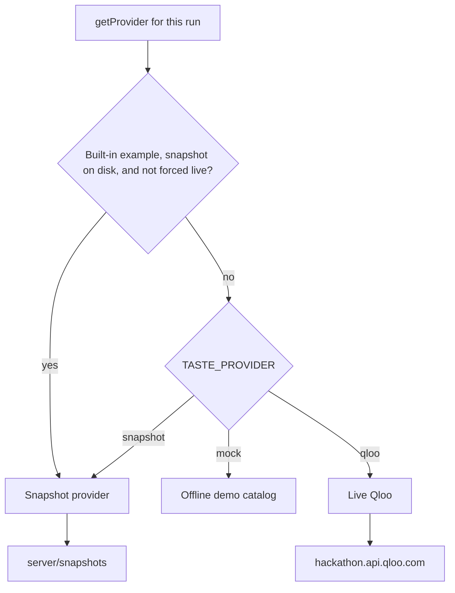

| Mode | What you get |
| --- | --- |
| `mock` | Full offline demo. No keys. Illustrative affinities, labelled as such. |
| `qloo` | Live Insights. Needs `QLOO_API_KEY`. |
| `snapshot` | Saved real Qloo results. `EXAMPLES_MODE=snapshot` (the default) also routes the three example chips here even when the rest of the app is mock, so judging does not burn quota. |

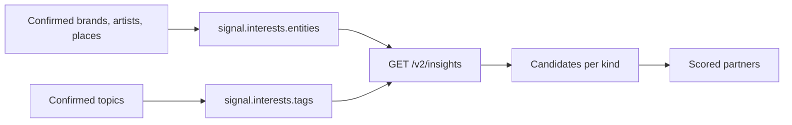

Only public entity and tag ids are sent. No customer lists, emails, or individual behaviour. Responses are validated before they become partners. The Qloo client retries on 429, paces itself, opens a circuit breaker after repeated failures, and refuses new live runs once the monthly quota falls below `QLOO_MONTHLY_FLOOR`.

Surfaces actually called: `/search`, `/v2/insights`, `/v2/tags`. Details and the method-to-endpoint map are in [docs/QLOO_INTEGRATION.md](docs/QLOO_INTEGRATION.md). Anchor resolution and the swipe deck are in [docs/ANCHORS.md](docs/ANCHORS.md).

## Briefs and Ask Venn

Both are written from a fact pack built only from this run: partners, scores, tags, evidence ids, and the decision log. Neither is allowed to invent a number.

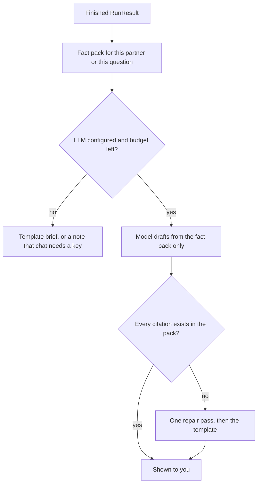

A brief is one page: a concept, why it fits with citations, a first step, a two-week plan, what to measure, risks, and an editable outreach email. Tone is warm, direct, or playful. Length is short or standard. Three concept variants. Copy as text, copy the email, or print.

Ask Venn is for questions about the finished search. If the answer is not in the data, it says it does not know. Replies that name partners show them as chips. Choosing a chip selects that partner across the Overview. Chat is capped per run (`LLM_CHAT_BUDGET_PER_RUN`, default 20). Brief regenerations are capped separately (`LLM_BRIEF_BUDGET_PER_RUN`, default 6).

`LLM_PROVIDER` is `openai`, `anthropic`, or `none`. With `none`, briefs use the deterministic template and the chat panel says it needs a key. The app will not boot if you name a provider and omit its key.

## Share, store, and limits

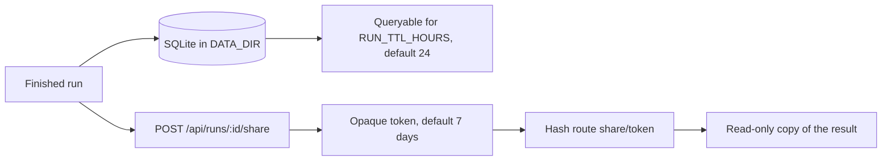

The share link is a snapshot, not a pointer at the live run, so it still works after the run expires. `GET /api/share/:token` never re-scores.

Finished runs survive a process restart. A host that sleeps mid-search still drops that one in-flight request. Do not buffer `text/event-stream`. The Vite proxy already sets `timeout` and `proxyTimeout` to 0. A reverse proxy needs the same.

A scheduler caps concurrent live searches. There is a per-IP daily cap (the IP is hashed) and a global rate limit. `GET /api/health` reports provider, queue, circuit state, whether an LLM is configured, and quota remaining. `GET /api/usage` is the last 14 days of Qloo HTTP calls and LLM completions, counted at the call site.

## How the code is split

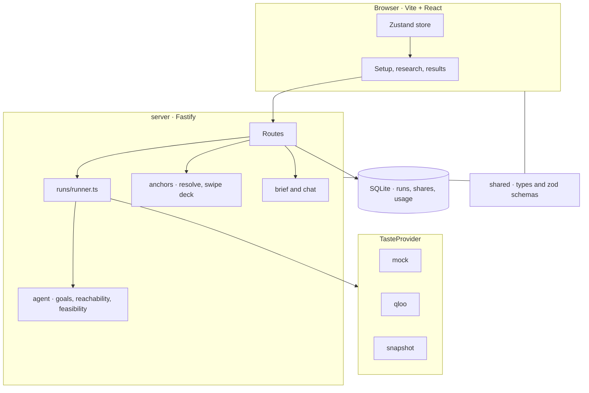

The browser only talks to `/api`. `shared/` is the contract for both sides.

```
src/                 React app. Setup, research screen, results.
  components/setup/     Sentence form and swipe deck
  components/research/  Live steps, Qloo feed, city map
  components/results/   Overview, shortlist, proof, brief, chat
  store/                Client state
server/              Fastify API.
  runs/                 Create, persist, schedule, and execute a search
  providers/            mock, qloo, and snapshot behind one interface
  anchors/              Typed resolve and the swipe deck
  agent/                Goals, reachability, feasibility
  brief/  chat/  llm/   Grounded writing
  routes/               HTTP
shared/              Types and zod schemas used by both
docs/                Scoring, Qloo contract, anchors, deploy
```

The older single Venn-diagram graph (`src/components/results/graph/`) is still in the tree. The Overview orbit chart and the Proof tab replaced it in the UI.

## API

| Method | Path | Role |
| --- | --- | --- |
| `GET` | `/api/health` | Provider, queue, circuit, store, LLM, quota |
| `GET` | `/api/usage` | Today's counts and 14-day history |
| `GET` | `/api/meta` | Business types, demo cities, examples |
| `GET` | `/api/examples` | Which examples have a saved snapshot |
| `POST` | `/api/anchors/resolve` | Type a chip, get a verified status |
| `POST` | `/api/anchors/cards` | Swipe deck for a business type and city |
| `POST` | `/api/anchors/cards/refill` | Next cards from the Yeses |
| `POST` | `/api/runs` | Start a search. Body is the business sentence |
| `GET` | `/api/runs/:id` | Current run, including a finished result |
| `GET` | `/api/runs/:id/events` | SSE. Pass `lastEventId` to resume |
| `DELETE` | `/api/runs/:id` | Cancel |
| `GET` | `/api/runs/:id/calls` | Qloo call log for this search |
| `POST` | `/api/runs/:id/proof` | Rank against the baseline |
| `POST` | `/api/runs/:id/check` | Score a partner you name |
| `POST` | `/api/runs/:id/compare` | Audience compare from stored signals |
| `POST` | `/api/runs/:id/brief` | Write or regenerate a brief |
| `POST` | `/api/runs/:id/chat` | Ask Venn |
| `POST` | `/api/runs/:id/expand` | Add neighbours of one partner, cap 28 |
| `GET` | `/api/runs/:id/heatmap` | Heatmap for one partner |
| `POST` | `/api/runs/:id/share` | Snapshot a finished result |
| `GET` | `/api/share/:token` | Read that snapshot |

## Scripts

| Script | What it does |
| --- | --- |
| `npm run dev` | Vite and the API together |
| `npm run typecheck` | App and server, no emit |
| `npm test` | Vitest |
| `npm run build` | Client bundle and server bundle |
| `npm start` | Production server |
| `npm run smoke` | Against a running server: swipe cards, a run, heatmap, brief |
| `npm run e2e:swipe` | Swipe flow at 1440px and 390px against a running mock app |
| `npm run cards:seed` | Resolve swipe-card seeds to exact Qloo ids |
| `npm run snapshot` | Capture saved Qloo results for the built-in examples |
| `npm run og` | Regenerate `public/og.png` |

The dev script passes `--tsconfig tsconfig.server.json` so `tsx` can resolve `@shared`. The root `tsconfig.json` only holds project references. `tsup` does not resolve TypeScript paths, so `tsup.config.ts` maps `@shared/*` onto `shared/*.ts`.

## Environment

See [.env.example](.env.example) for the full list and defaults.

| Variable | What it controls |
| --- | --- |
| `PORT`, `HOST` | API bind address. Production reads `PORT` from the host. |
| `TASTE_PROVIDER` | `mock` (default), `qloo`, or `snapshot`. |
| `EXAMPLES_MODE` | `snapshot` (default) replays the three examples from disk. `live` sends them to Qloo too. |
| `MOCK_LATENCY` | `normal`, `fast`, or `off`. |
| `QLOO_API_KEY`, `QLOO_BASE_URL` | Required for live Qloo. Base URL default is the hackathon host. |
| `QLOO_MAX_RPS`, `QLOO_MAX_IN_FLIGHT` | Client-side pacing. |
| `QLOO_CIRCUIT_FAILURES`, `QLOO_CIRCUIT_COOLDOWN_MS` | Circuit breaker. |
| `QLOO_MONTHLY_FLOOR` | Refuse new live runs below this many calls remaining. |
| `LLM_PROVIDER` | `openai`, `anthropic`, or `none`. |
| `OPENAI_API_KEY`, `ANTHROPIC_API_KEY` | The key for the provider you named. |
| `LLM_MODEL`, `LLM_MODEL_FAST` | Model ids. |
| `LLM_BRIEF_BUDGET_PER_RUN`, `LLM_CHAT_BUDGET_PER_RUN` | Per-run caps. |
| `DATA_DIR` | SQLite directory. Mount a volume in production. |
| `SNAPSHOT_DIR` | Saved example results. Default `./server/snapshots`. |
| `RUN_TTL_HOURS` | How long a finished run stays queryable. Default 24. |
| `SHARE_TTL_HOURS` | Share-link lifetime. Default 168. |
| `MAX_CONCURRENT_RUNS`, `QUEUE_MAX` | Scheduler. |
| `DAILY_RUN_CAP_PER_IP` | Per-network daily cap. |
| `RATE_LIMIT_MAX`, `RATE_LIMIT_RUNS_PER_MIN` | Request limits. |
| `TRUST_PROXY` | Set `true` behind a reverse proxy so the IP cap sees the client. |
| `PROOF_MAX_CALLS` | Cap on proof ranking calls. |

## Further reading

| Doc | What it covers |
| --- | --- |
| [docs/ALL_FEATURES.md](docs/ALL_FEATURES.md) | Everything that is shipped, checked against the code |
| [docs/QLOO_INTEGRATION.md](docs/QLOO_INTEGRATION.md) | Provider methods and the hackathon API |
| [docs/QLOO_CONTRACT_V2.md](docs/QLOO_CONTRACT_V2.md) | Request and response contract |
| [docs/QLOO_COVERAGE.md](docs/QLOO_COVERAGE.md) | What the hackathon host actually returned |
| [docs/SCORING.md](docs/SCORING.md) | Live mutual affinity and the demo band |
| [docs/ANCHORS.md](docs/ANCHORS.md) | Typed resolve and the swipe deck |
| [docs/DEPLOY.md](docs/DEPLOY.md) | Railway, Fly.io, Docker, health checks |
| [docs/DEVPOST.md](docs/DEVPOST.md) | How Qloo is used, for the submission |

## Responsible use

Scores compare taste between groups for this one search. Briefs and chat answers are written from that search's evidence, or from the template when no model is configured. They are a draft to edit. Do not send one unread.

No personal data is sent to Qloo or to an LLM. Keys stay on the server. Fonts are self-hosted.

## License

MIT. See [LICENSE](LICENSE).
