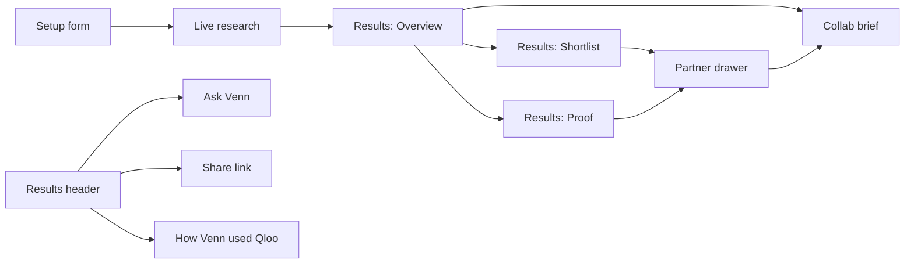

# Venn — everything that is built

Plain-language list of what the product can do today, verified against the current code. If it
isn't listed here, it isn't shipped, or it's listed under "Built but not currently reachable" at
the end.

---

## Big picture



Venn finds the businesses and brands whose audiences already overlap with yours, shows that
overlap on a dashboard and a map, and drafts the pitch. Taste data comes from Qloo — live, a
saved Qloo snapshot, or an offline demo catalog, depending on `TASTE_PROVIDER`.

The results bar (Overview, Shortlist, Proof, Help, Ask Venn, How Venn used Qloo, Share, New
search) is the same on every results tab. It also restates the search: business type, city, and
the first two tastes.

---

## 1. Setup

The cover is one sentence: "I run a [type] called [optional name] in [city]." Types are café,
restaurant, bar, music venue, gym or studio, shop, fashion brand, bakery, bookshop, salon or spa,
hotel, coworking space, or **other** with a short custom description. Under that: "My customers
love…" — one shared list of up to six tastes, filled by swiping or typing.

- **Swipe your crowd** — a deck of taste cards (brands, artists, places, topics) in the example
  panel's spot on a laptop, or a bottom sheet on a narrower screen. Right arrow or the Yes button
  keeps a card; left arrow or "Not really" skips it; Z undoes the last swipe (and drops a refill
  that swipe had just pulled in). Escape closes the deck. A Yes flies onto the chip list. After
  the third Yes, up to three more cards are drawn live from Qloo based on what you kept
  (`POST /api/anchors/cards`, `/cards/refill` — see `docs/ANCHORS.md`). From three tastes onward
  you can stop early ("That is enough") and search, or keep going to six. Each card says where it
  came from: popular nearby and from Qloo, suggested for your business type and checked on Qloo,
  refilled because you said yes to something, a recorded example, or a sample card that is not
  from Qloo. Changing the business type or the city throws the deck away. If that city has no
  cards, the panel says so and offers typing instead.
- **Type them** — Enter (or a comma, including a pasted comma-separated list) adds a chip, which
  is resolved against Qloo as you go. A clear entity or topic is applied on its own, and the chip
  shows Qloo's name. An ambiguous phrase is not a picker: the highest-scoring hit is applied, and
  a tie goes to the brand or artist when you capitalised it ("Aesop") and to the topic when you
  didn't ("yoga"). Anything still unmatched stays on the list as a **Note** and is not used to
  rank partners. A duplicate of a taste already on the list is dropped. You need at least one
  matched taste to start; notes alone are refused.
- **Fine-tune the search** (optional, collapsed by default, with a count of anything you've set):
  - Up to two collaboration goals (more footfall, a new audience, content, events, bundles,
    shared costs, stockists). They never change the match score. They do change which partner
    kinds are searched first, can leave out an avoided kind, can narrow the pool by distance
    (without emptying it), reorder the three top picks within a small tolerance, and add a
    "goal fit" note.
  - How far to look: Just nearby / Local + known brands / Anywhere.
  - Appetite: a small trial, medium, or ambitious.
  - An "avoid" list of up to ten partner types or names.
- Three example chips fill the sentence and stream the tastes in one click: Brew & Co in London
  (Aesop, Radiohead, pilates), a gym or studio in Manchester (Patagonia, craft beer, bouldering),
  and Second Spin Records in New York (Bandcamp, Polaroid, natural wine). In snapshot mode those
  examples replay saved Qloo results.
- On a first visit the sentence is already a café in London called Brew & Co, with Nike, Spotify
  and yoga. After you edit it, the browser remembers your last answers.
- You can search with one taste; the form says three or more works best.
- A live example panel beside the form — "Example: what you get" — auto-cycles every 8 seconds
  through three views of a saved London café search (Brew & Co, against partners such as VIU
  Eyewear, Rains, Patagonia, Tate Modern): a **Signal** orbit (thicker cable = stronger match),
  a **Heat** taste-vs-partner heatmap, and a ranked **Scores** board. Hovering pauses the
  auto-advance; reduced motion does not auto-advance. Clicking a partner selects it on all three
  slides. Opening the swipe deck replaces this panel until you close it.
- **How it works** reopens the welcome walkthrough. **About** (also `#about`) is a short dialog:
  what Venn is, the three steps, and which Qloo surfaces the server actually calls. A source-code
  link sits in the header and footer.

---

## 2. Research (while it searches)

- Seven steps, streamed live over SSE, each with its own state (waiting / running / done /
  retry): understand taste → choose where to look → search for candidates → score fit → check
  trends and local popularity → double-check coverage → draw the map. The step that is running
  shows one plain-English line, then the latest note from that step (what kinds it's looking at,
  how many places came back, how many look open).
- A live map of the search city fills in as anchors resolve and candidate kinds are chosen, with
  a progress gauge. When the search finishes, "See your N partners" jumps to the results. Open
  and closed venue counts show on the coverage step.
- "From Qloo" shows the last two live calls as they happen (request shape in, summary back, with
  timing). The full call list is the results panel in section 10.
- You can cancel mid-search. A page refresh reconnects to the same in-flight search. If it fails,
  you can try again or go back and edit the sentence.
- An unsupported city doesn't invent local data — the map is replaced by the two-circle loader,
  the search looks at brands and artists, and the screen says there is no map for that city.
- A live Qloo run with no usable named taste (no matched brand, artist or place, and no topic
  that could be bridged to one) stops with an explanation instead of ranking whatever is popular
  nearby.

The agent's "why" lines (for example "Did not widen the search — 19 strong matches already") are
saved on the finished run and given to Ask Venn. They are not drawn on the research screen or the
results page.

---

## 3. Results — Overview

The default results view. One selected partner drives every chart, so clicking a dot, a bar, a
pin or a card follows that partner through all of them. Hovering lights the same partner
everywhere and shows a small tip. The page shows at most 12 partners after filters; the Shortlist
still has the full set (up to 28).

- A headline ("[name] is your strongest overlap…") and four counts: partners on screen, best
  overlap, how many are easy to reach, and how many local places are within 3 km.
- **Orbit chart** — you in the centre, partners grouped by kind, closer to the centre means a
  higher overlap. This chart, and the scatter, map, flow, compare, and themes charts, each have
  a **Chart / Table** switch that shows the same numbers as a table.
- **Picks panel** — "Start with these three", reordered as you move the safe-fits slider, plus
  up to five more under "also worth a look".
- **Selected card** — "Why they match": a two-circle mark, the overlap score, distance or "no
  fixed location", the top shared tastes as scored bars, which of your anchors Qloo says drove
  the match, a one-line opener, and buttons to draft outreach or add to the shortlist.
- **Scatter chart** — overlap along the bottom. The vertical axis is how easy the partner is to
  approach, and slides toward "how surprising" as the wildcard slider passes halfway. The shaded
  corner is labelled "Message first" or "Bold bets" to match. Dot size follows Qloo popularity
  when that number exists.
- **Map panel** — pins for local places. Taste lift starts on: the shading is where your crowd
  over-indexes, and turning it off shows raw popularity instead. Brands and artists with no fixed
  location are listed under the map.
- **Flow chart** — your tastes, the shared themes, and the top partners, with thicker bands where
  more of the match comes from that taste.
- **Your crowd vs theirs**, for the selected partner, when that compare has bars to draw.
  Otherwise the same slot is **What your crowds have in common**: the shared tastes that carry
  the most overlap across the top partners, and which partners they feed.
- **"Pull a taste" tags** under the orbit. A press pins that taste and dims partners that don't
  share it, on every chart. Dragging the tag over the orbit pulls the partners that share it
  toward the cursor; letting go snaps them back.
- Filters that apply to every chart on this page: one kind at a time (with counts), a
  safe-fits-to-wildcards slider, and a "realistic for me" toggle that hides long-shot partners.

---

## 4. Results — Shortlist

- Two lists: partners you've pinned, then everyone else. Each row shows kind, distance or "no
  fixed location", a feasibility chip (Easy ask / Warm intro / Long shot), a one-line reason, up
  to three shared tastes, and the match score. A "Your pick" tag marks someone you added from
  Proof.
- Sort by match, surprise, name, or goal fit (goal fit only appears if you set goals). Filter by
  kind. Pinned rows stay in their own list, in that sort order.
- Pin from the row, from the Overview's selected card, or from the partner drawer. The Shortlist
  tab shows how many are pinned. Pins last for this visit; a refresh starts the list empty again.
- Each row can open the partner drawer or jump straight to the collaboration brief.
- A summary strip: pinned count, best match, local places, and how many kinds.
- CSV of the rows you're looking at (the current kind filter, pinned rows first).

---

## 5. Partner drawer (from the Shortlist or Proof)

Opens when you select a row. Escape or the scrim closes it. The Overview uses the selected card
instead of this drawer.

- Match score out of 100, labelled as mutual Qloo affinity when the run's scores are absolute,
  otherwise as relative to this search.
- The reasons behind the match, shared tastes, and the explainability line when Qloo says which
  of your anchors drove it.
- Feasibility and goal-fit chips. An AI-adjusted feasibility tier says so.
- Venue details for place partners: address and website. Distance in kilometres when known.
- **Compare crowds** toggles the audience compare: shared tastes, tastes only your crowd rates
  highly, tastes only theirs does. It is built from signals already computed while scoring, not a
  fresh Qloo probe.
- Evidence split into **data** (a real number) vs. **interpretation** (what Venn makes of it).
- **Also pairs well with** — other partners in this search linked from this one. Clicking one
  opens that partner.
- Create the collaboration brief, pin or unpin, or **Find more like this** (adds connections
  until the search hits 28 partners).

---

## 6. Proof (and Check a partner)

Open from the results header. The comparison loads when you open the tab.

- **Proof**: ranks Venn's own picks together with an "obvious" baseline — the popularity
  leader, or an LLM-suggested well-known name when one is configured — in the *same* Qloo
  `rankTogether` call per kind, so the two scores are directly comparable. A head-to-head bar
  shows the run's average score for each side, a plain-English verdict ("+N average points ahead"
  or behind), and a per-kind breakdown with a Venn-ahead / baseline-ahead / tied badge.
- Bounded by `PROOF_MAX_CALLS`. A kind with no recorded discover call (a legacy run, or a
  provider that can't replay one) shows a note instead of a guessed score.
- **Check a partner**: type any brand, artist or place and Venn scores it on this search's
  frozen scale, adding it to the Overview as a dashed "Your pick" node — up to 5 per search.

---

## 7. Collaboration brief

Opened from the Overview's selected card ("Draft outreach"), a Shortlist row ("Brief"), or the
drawer ("Create partner brief").

- One-page pitch per partner: concept, why it fits (with footnote-style citations into a
  sources list), a first step, a two-week plan shown as a timeline, what to measure, risks, and
  an outreach email whose subject and body you can edit before copying.
- A "fit lens" in the header — the two-circle mark with the overlap score in the shared sliver —
  plus the format and partner kind as pills. While it is being written, a branded placeholder
  stands in for the page.
- Tone (warm / direct / playful) and length (short / standard), another concept to cycle through,
  and a regenerate button.
- Written by an LLM from the run's own evidence when one is configured; falls back to a
  deterministic template otherwise. Either way, nothing is invented — an LLM citing an evidence
  id that doesn't exist in the run's own fact pack fails validation and gets rewritten or
  replaced by the template, never shown as-is. The brief never says who or what wrote it. The
  footer says "Powered by Qloo" or "Demo data".
- Copy as text, copy the outreach email, or print / save as PDF.

---

## 8. Ask Venn (chat)

- A chat panel, open from the results header, for free-form questions about the finished search.
  Three starters are offered when a model is available: who is easiest to approach, why the top
  pick ranked where it did, and which partners have a real location nearby.
- Grounded the same way the brief is: the model gets a fact pack built only from this run's real
  partners, scores, tags and decisions (including the widen-or-not lines from research), and is
  told to say "I don't know" rather than guess when the question falls outside it.
- Replies that name specific partners show them as clickable chips; clicking one selects that
  partner, which highlights it across every Overview chart the same way clicking a chart element
  does.
- Remembers the conversation for natural follow-ups, capped per run
  (`LLM_CHAT_BUDGET_PER_RUN`, default 20 replies).
- No LLM configured, or budget spent: a calm note in the panel explains that, rather than a
  broken input or a fake answer.

---

## 9. Share

- The Share button calls `POST /api/runs/:id/share` and copies `#share/<token>` to the clipboard.
  Default life is 7 days (`SHARE_TTL_HOURS`, or `SHARE_TTL_DAYS` when that is set). The snapshot
  is a read-only copy, not a link back to the live run, so it still works after the run itself
  expires.
- The share page is a short read-only view: the run headline, the top picks, and every partner
  ranked by score with kind, local-or-brand, and one reason. It does not include the dashboard,
  pins, chat, or briefs. An expired or unknown token says the link wandered off and offers a new
  search.

---

## 10. How Venn used Qloo

- A panel, open from the results header, listing every live Qloo HTTP call this search made —
  grouped by research step, with the path, params (redacted/truncated, no secrets), and timing.
- Demo and snapshot runs say plainly that no live Qloo calls were made, instead of showing an
  empty list with no explanation.

---

## 11. Taste data (providers)

| Mode | Meaning |
| --- | --- |
| Mock | Built-in demo catalog — works fully offline, no keys needed |
| Qloo (live) | Real hackathon API, key held server-side only |
| Snapshot | Saved real Qloo results for the three built-in examples, so judging doesn't burn quota |

`TASTE_PROVIDER` picks the default. `EXAMPLES_MODE` separately controls whether the three
built-in examples always replay their saved snapshot or always go live.

---

## 12. In-app guidance

- **Welcome walkthrough** — four short slides on first visit (what Venn does, then the three
  steps), ending with "Try a ready-made example" or "Use my own business". Reopen any time from
  "How it works" in the setup header. Choosing the example fills the London café.
- **Results tour** — a spotlight walk through the Overview (headline, filters, orbit, top picks,
  why-they-match, overlap-vs-ease, tabs, header actions) that starts once after the first
  finished search, once the charts have drawn. Reduced motion starts it sooner. Replay from
  **Help**; if you're on another tab, Help switches you back to the Overview first.
- **Help panel** — opened from the results header: the tour, a three-step "what to do", what each
  tab is for, and a glossary of the terms the app uses.
- **Info buttons** — a small "i" next to every chart, filter, stat, fine-tune field, the taste
  list, Shortlist, Proof, the brief and the research feed, each with a plain-English explanation.
- All copy lives in `src/lib/guide.ts`. "Seen" flags are kept in the browser only.

---

## 13. Honesty and safety, built into the product

- Match scores are relative to this one search and group-level — never a claim about an
  individual, and no customer data is used. When the provider returns absolute mutual affinity,
  the drawer says so.
- Every number and sentence is traceable to where it came from: a real Qloo figure, a rule, or
  an LLM citing a specific piece of evidence from the run.
- No personal data, customer lists, emails, or phone numbers are ever sent to Qloo or an LLM.
- API keys never reach the browser.
- Security headers on; fonts self-hosted. Map tiles come from OpenFreeMap.

---

## 14. Ops / reliability (server)

- Runs persist in SQLite (`DATA_DIR`), so a restart doesn't lose a finished search
  (`RUN_TTL_HOURS`, 24h default). Opening the app again restores a finished run, or reconnects
  to one that is still going.
- A queue limits how many live searches run at once, plus a per-IP daily cap on live runs, and
  a global per-minute rate limit.
- Qloo client: retries on 429, a circuit breaker, client-side rate pacing, and a monthly-quota
  floor that refuses new live runs once the key is running low (so it survives through judging).
- `GET /api/health`: provider, store, queue depth, circuit state, whether an LLM is configured,
  quota remaining, and today's Qloo and LLM call counts.
- Usage ledger: `GET /api/usage` for today plus the last 14 days.
- Per-run Qloo call log and chat/brief budgets, each capped independently.
- Production is one process: the API and the built site. `npm run dev` is the website on port
  5173 and the API on port 8787, with `/api` proxied.

---

## Built but not currently reachable in the UI

These still compile. Nothing in the app mounts them.

- The old single Venn-diagram graph (`src/components/results/graph/`, including its legend,
  controls, and the surprise slider it was the only user of).
- The old results chrome: `TopBar` / `MobileTabs`, `TopPicks`, `AgentNotes` (the on-screen
  decision list), and `MapView` (a full-page map; the Overview map replaced it).
- The old research chrome: `ToolLog` (which did print decision events) and `StepTimeline`.
- `AnchorConfirm`, a stub that renders nothing.
- AI rewrites for a typed taste that is too broad or unmatched. The resolver still asks for
  them, checks each one against Qloo, and attaches only the verified ones to the response. The
  setup form never reads that list — the chip stays a Note.

---

## Not built (on purpose or out of time)

- Age-band demographics UI (Qloo returned empty in probing)
- Live trend sparklines (the trending endpoint failed on the hackathon host)
- A full partnership PDF pack (the brief itself can be printed or saved as PDF)
- Agency brand-kit white-label
- Three-way Venn (business + two partners at once)
- A dedicated Playwright end-to-end suite (covered today by ad hoc Playwright scripts + Vitest
  instead)

---

## How to run it

Node `>= 22.19`.

```bash
npm install
npm run dev
```

- Website: http://localhost:5173
- API: http://localhost:8787

`TASTE_PROVIDER` defaults to `mock`, so this runs with no API keys. For live data, set
`TASTE_PROVIDER=qloo` and `QLOO_API_KEY`; for AI briefs and chat, set `LLM_PROVIDER` and a
matching key. See the root `README.md` and `.env.example` for the full list.
